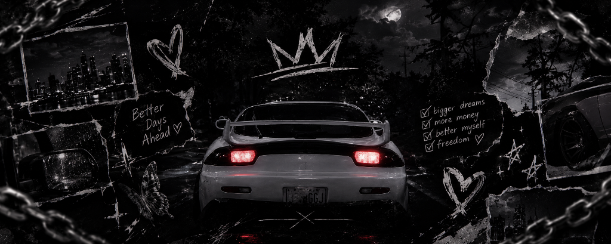
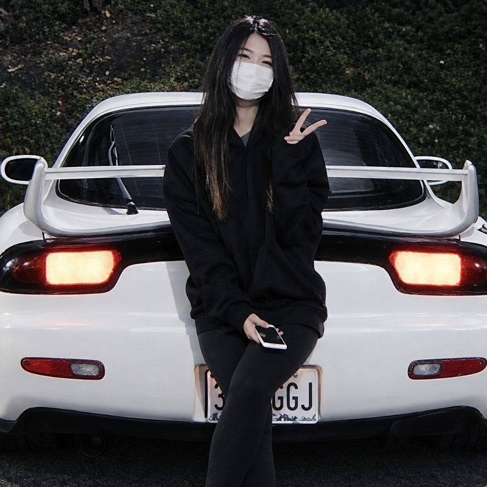

<div align="center">
  
  <br />
  <br />
  

  <h1>BhuIe</h1>
  <p><strong>@BhuIe</strong> • Online • Plugins &amp; Gaming</p>
  <p><em>PC Setup, Daily Apps &amp; Configs</em></p>

  <p>
    <a href="https://bhuiee.github.io/Zyneth/"></a>
    <a href="https://guns.lol/BhuIe"></a>
    <a href="https://namemc.com/profile/BhuIe.1"></a>
    <a href="https://www.roblox.com/users/11353392590/profile"></a>
    <a href="https://www.twitch.tv/o_bhuie"></a>
    <a href="https://discord.gg/6PwYjKv5fS"></a>
    <a href="https://www.youtube.com/@BhuIe"></a>
  </p>
</div>

---

## `01 / RIG & PERIPHERALS` — PC Setup & Gear

| Category | Component / Gear | Details |
| :--- | :--- | :--- |
| **CPU** | **Intel Core i5-13400F** | 13th Gen • 10 Cores (6P+4E) / 16 Threads • Up to 4.6 GHz |
| **GPU** | **NVIDIA GeForce RTX 4060** | 8GB GDDR6 • Ada Lovelace • DLSS 3 |
| **RAM** | **16GB System Memory** | Dual Channel Configuration |
| **Monitor** | **240Hz ASUS TUF VG259QM5A** | 24.5" 1080p 240Hz Fast IPS • G-Sync Compatible |
| **Mouse** | **Attack Shark X3** | 49g Ultralight Wireless • PAW3395 • 900 DPI @ 1000Hz |
| **Keyboard** | **Akko TAC75 HE (Black)** | 75% Hall Effect Magnetic Switches • Rapid Trigger |
| **Primary SSD (`C:`)** | **256GB Micron 2450 NVMe** | PCIe Gen4 x4 M.2 SSD • OS & Core Apps |
| **Secondary Storage (`Y:`)** | **1TB WD Blue (`WD10EZEX`)** | `"Zyneth"` • Games & Media Library |

---

## `02 / WORKFLOW & TUNING` — Software, Apps & Configs

### Sensitivity & Display Parameters

| Parameter | Setting |
| :--- | :--- |
| **Mouse DPI & Polling** | `900 DPI • 1000 Hz` |
| **MC Sensitivity** | `31% • Raw Input ON` |
| **FOV & View** | `90 FOV • Dynamic FOV & Bobbing OFF` |
| **FPS & Display** | `240 FPS Cap • VSync OFF • GUI Scale 2` |
| **Render & Simulation** | `10 Chunks Render • 6 Chunks Sim` |
| **Graphics Tweaks** | `Entity Shadows OFF • Smooth Lighting OFF` |

### Daily Software Stack

| Application | Category | Notes |
| :--- | :--- | :--- |
| **Helium Browser** | `Daily Driver` | Ultralight, privacy-focused for my daily browsing. |
| **Pandora Launcher** | `Launcher` | Main launcher for Minecraft. |
| **Medal.tv** | `Clips` | Gameplay clipping. |
| **Discord & Spotify** | `Social` | Daily voice comms, SMP servers, and background playlists. |
| **Roblox** | `Games` | Just normal Roblox |
| **Windows 11 Home (26H2)** | `System` | Build 26300 • Hardware-accelerated GPU scheduling enabled, Game Mode ON. |

### Config Snippets & Keybinds

**Minecraft Hotbar & PvP Keybinds** *(Pandora Launcher • Custom Keybind Layout)*
```text
Hotbar 1–9 : [1] [Q] [E] [4] [R] [Z] [C] [V] [Mouse 4]
Inventory  : Tab          | Offhand Swap : F
Drop Item  : X            | Sprint       : 5 (Toggle Sprint ON)
Perspective: Mouse 5      | Player List  : Y
Zoom       : G (Zoomify)  | Optimizer    : Right Shift
```

**Minecraft Video & Resource Pack Setup** *(240Hz PvP Optimized Settings)*
```text
Resolution : 1920x1080 @ 240Hz (Fullscreen ON, VSync OFF)
FOV / Sens : 90 FOV (0.0 FOV Effect Scale) | 31% Sens | GUI Scale 2
Distances  : 10 Render | 6 Simulation | Clouds & Vignette OFF
Packs      : vanilla pvp 1.33.zip, Reaper's PVP Pack.zip, Fast Better Grass.zip
```

---

## `03 / MISC` — Other Things & Rotation

- **Currently Playing:** Minecraft (PvP / SMPs / Survival), Roblox, GTA V & CS2
- **Minecraft Packs:** `vanilla pvp 1.33` • `Reaper's PVP Pack` • `Vix`
- **Client & Mods:** Pandora Launcher + Zyneth Optimizer *(Fabric with EntityCulling, GammaUtils, Zoomify, Iris, and Zyneth Optimizer)*

---

## `04 / CONNECT` — Social Links & Profiles

- 🌐 **Live Page:** [bhuiee.github.io/Zyneth](https://bhuiee.github.io/Zyneth/)
- ⚡ **guns.lol:** [guns.lol/BhuIe](https://guns.lol/BhuIe)
- 🟩 **NameMC:** [namemc.com/profile/BhuIe.1](https://namemc.com/profile/BhuIe.1)
- 🎮 **Roblox:** [BhuIe](https://www.roblox.com/users/11353392590/profile)
- 💜 **Twitch:** [twitch.tv/o_bhuie](https://www.twitch.tv/o_bhuie)
- 💬 **Discord:** [discord.gg/6PwYjKv5fS](https://discord.gg/6PwYjKv5fS)
- ▶️ **YouTube:** [@BhuIe](https://www.youtube.com/@BhuIe)
- 🐙 **GitHub:** [github.com/BhuIee](https://github.com/BhuIee)
